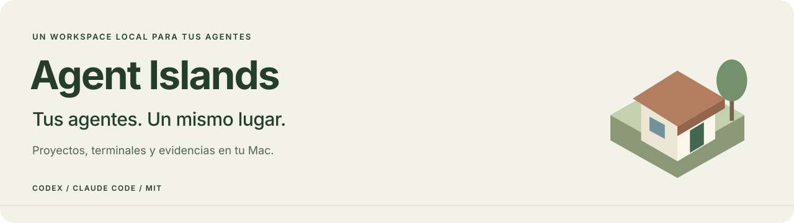
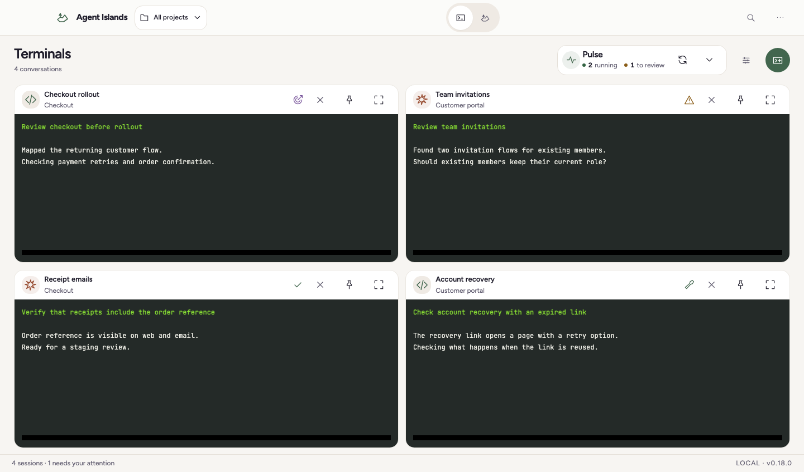
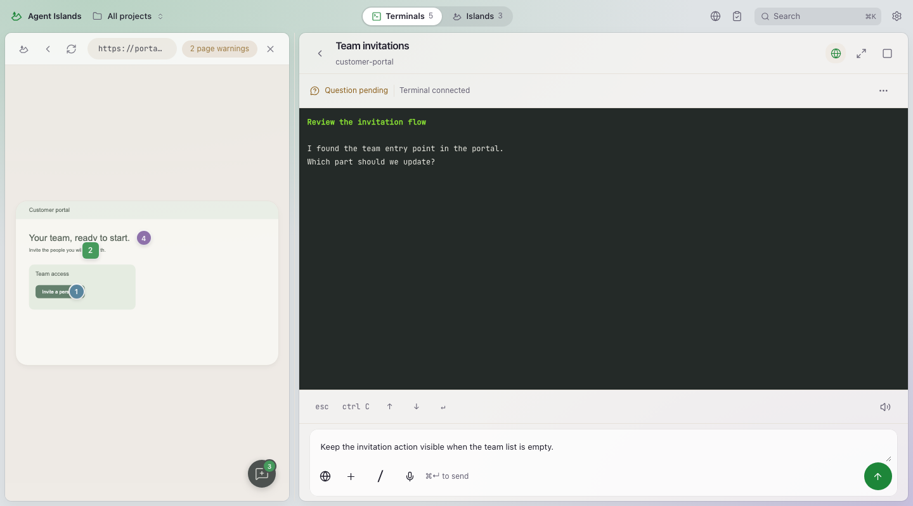

**Sigue el avance y decide dónde intervenir.** Agent Islands reúne Codex y Claude Code en un workspace para macOS. Cada proyecto conserva sus conversaciones y las evidencias que permiten comprobar qué se ha entregado.

[English](README.md) · [Compilar en macOS](#instalación) · [Historial de cambios](CHANGELOG.md)

<picture>
  <source media="(prefers-color-scheme: dark)" srcset="docs/assets/workspace-dark.png">
  
</picture>

## Qué puedes hacer

- **Trabaja en varios proyectos sin perder el hilo.** Agrupa repositorios en workspaces, guarda vistas con las terminales prioritarias y retoma conversaciones en su carpeta original. Usa perfiles separados para el trabajo y la cuenta personal.
- **Resuelve las decisiones pendientes.** Pulso señala goals bloqueados, preguntas y permisos pendientes. Abre el agente correspondiente o envíale «Continúa» cuando haya terminado su turno y pueda seguir.
- **Retoma el trabajo con contexto.** El checkpoint muestra la fecha, el avance del producto, los cambios y el siguiente paso. Puedes actualizarlo cuando se registra actividad nueva.

## Del feedback a una entrega verificable

Abre el producto junto a la terminal. Señala un componente o graba un recorrido y adjúntalo a tu petición. Ejecuta pruebas en un entorno registrado y guarda capturas y resultados con la revisión que se haya configurado. [Guía de navegador y QA](docs/QA.md)



*Capturas con datos de demostración.*

## Instalación

La vista previa para desarrolladores se compila en macOS 14+ con Xcode Command Line Tools y Node.js **24.22.2**. Instala y autentica Codex CLI, Claude Code o ambos por separado.

```bash
git clone https://github.com/AlexHHPS/agent-islands.git
cd agent-islands
npm ci
npm run build
open "build/Agent Islands.app"
```

La compilación usa firma local ad hoc. Apple Silicon está validado. Quedan pendientes la validación en Intel y un instalador público notarizado. Los resúmenes generados usan Ollama en local o el servidor compatible que configures. [Desarrollo](docs/DEVELOPMENT.md) · [Privacidad](docs/PRIVACY.md) · [Arquitectura](docs/ARCHITECTURE.md)

## Licencia y colaboración

Agent Islands es un proyecto independiente bajo [Apache 2.0](LICENSE), que permite el uso comercial. Para integraciones o soporte comercial, contacta con [@AlexHHPS en Discussions](https://github.com/AlexHHPS/agent-islands/discussions). [Contribuir](CONTRIBUTING.md) · [Licencias de terceros](THIRD_PARTY_NOTICES.md)
