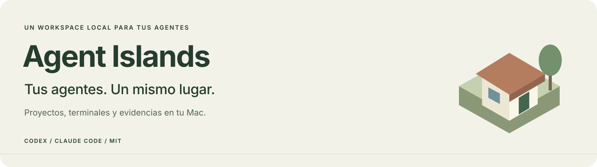
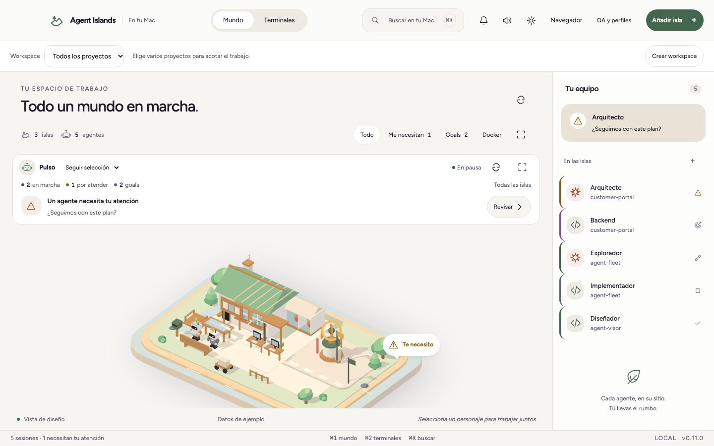
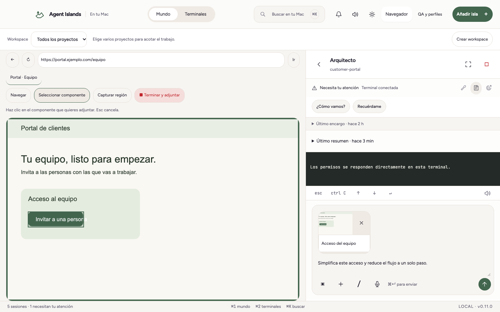

**Un workspace local para Codex y Claude Code en macOS.** Reúne proyectos, terminales, conversaciones y evidencias del navegador en un mismo lugar. Cada proyecto tiene su isla y cada agente muestra su estado.

[English / documentación completa](README.md) · [Instalación](#instalación) · [Contribuir](CONTRIBUTING.md) · [Licencia Apache 2.0](LICENSE)



## Qué puedes hacer

- Agrupar varios proyectos en un workspace y acotar el contexto visible.
- Abrir conversaciones nuevas o recuperar las guardadas junto a su directorio original.
- Usar perfiles separados, incluido `claude-personal`, con sus propias configuraciones.
- Trabajar con terminales reales, anclar las prioritarias arriba y consultar checkpoints de progreso por conversación.
- Distinguir goals activos, bloqueados, pausados y completados sin confundir presupuesto con avance.
- Controlar un navegador Chromium, seleccionar un componente o una región y añadirlo al borrador del chat.
- Grabar un recorrido y enviar vídeo, fotogramas y pasos como referencia para un cambio.
- Comprobar entornos desplegados con autenticación por perfil y evidencias de QA.
- Configurar resúmenes opcionales con un servidor compatible y claves en el llavero de macOS.



## Instalación

Vista previa para desarrolladores: macOS 14+, Xcode Command Line Tools, Node.js 24.22.2 y npm. Instala y autentica Codex CLI o Claude Code por separado. Docker es opcional; las pruebas del PTY usan Python 3.

Desde el directorio del repositorio:

```bash
git clone https://github.com/AlexHHPS/agent-islands.git
cd agent-islands
npm ci
npm run check
npm run build
open "build/Agent Islands.app"
```

La compilación genera la aplicación y `dist/Agent Islands.dmg` para la arquitectura del Mac. La firma es ad hoc; el instalador no está notarizado. Apple Silicon está validado localmente; la compilación Intel requiere validación en hardware Intel.

Añade un directorio y crea un agente desde el **+** de su isla. El selector permite elegir un directorio activo, uno nuevo o recuperar el de una conversación anterior. En **Workspaces** puedes agrupar proyectos y elegir uno principal.

Para el navegador, abre **QA y perfiles → Salud → Preparar QA** y abre una URL pública o local, o trae una pestaña existente de un Chromium compatible conservando su acceso SSO. Puedes seleccionar componentes, capturar regiones o grabar recorridos. Las referencias se quedan en el borrador hasta pulsar **Enviar**. Su uso posterior depende del harness y del modelo.

## Idioma

Abre el botón de ajustes y elige **Castellano** o **English** en **Idioma de la aplicación**. Se aplica al instante y se guarda para las próximas aperturas. La aplicación nativa usa inicialmente el idioma del Mac, con inglés como alternativa. Los textos propios, menús, QA, fechas, dictado y resúmenes siguen esta preferencia; tus mensajes, borradores y conversaciones conservan su contenido.

## Datos y permisos

El estado de la app se guarda en `~/Library/Application Support/Agent Islands/`. Los perfiles usan directorios de configuración separados. Las claves del servidor de resúmenes se guardan en el llavero; las actualizaciones automáticas empiezan desactivadas.

Al pedir un resumen, el contexto seleccionado se envía al servidor configurado. Los agentes y las páginas visitadas mantienen su propio acceso a red. Un workspace organiza contexto y argumentos del harness; no crea un aislamiento de seguridad del sistema operativo.

Consulta [privacidad](docs/PRIVACY.md), [QA](docs/QA.md), [desarrollo](docs/DEVELOPMENT.md) y [arquitectura](docs/ARCHITECTURE.md) para los detalles.

## Desarrollo y contribuciones

```bash
npx playwright install chromium
npm run check
npm test
npm run test:native
npm run check:source
```

`npm test` necesita la aplicación compilada. Las pruebas usan fixtures; no envían prompts reales a proveedores. La interfaz completa está disponible en castellano e inglés. El README principal y las guías técnicas están en inglés para facilitar contribuciones.

Lee [CONTRIBUTING.md](CONTRIBUTING.md), el [código de conducta](CODE_OF_CONDUCT.md), las [reglas de gobierno](GOVERNANCE.md), [soporte](SUPPORT.md), [SECURITY.md](SECURITY.md) y el [changelog](CHANGELOG.md). Proyecto independiente bajo [Apache 2.0](LICENSE), con [licencias de terceros](THIRD_PARTY_NOTICES.md).

## Uso comercial y contacto

Apache 2.0 permite el uso comercial sin pedir permiso ni pagar una licencia. Si lo usas en tu empresa, contacta con [@AlexHHPS](https://github.com/AlexHHPS) en [Discussions](https://github.com/AlexHHPS/agent-islands/discussions) para hablar de integraciones, colaboración o soporte comercial. El contacto es voluntario y no es una condición de la licencia.

Las revisiones públicas anteriores hasta [`a4d6705`](https://github.com/AlexHHPS/agent-islands/blob/a4d670518e059fec07ae102b50e579503c64f9bc/LICENSE) se ofrecieron bajo MIT y conservan sus permisos.
