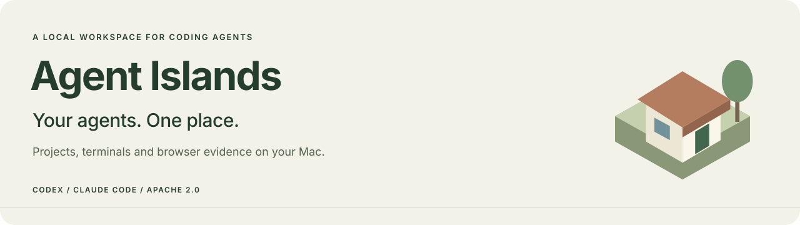
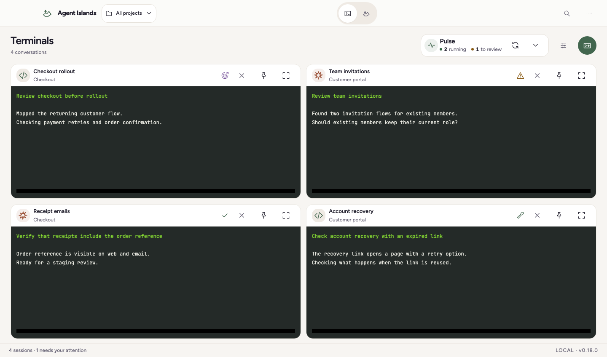
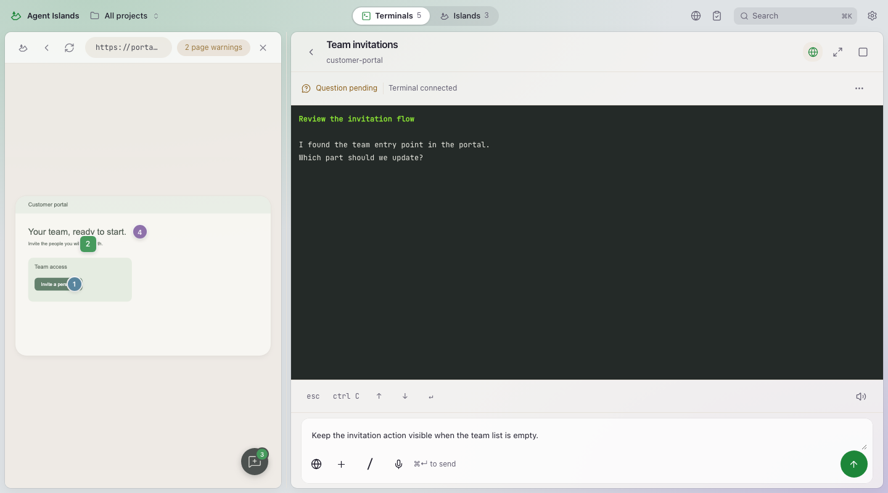

**See where work stands and which decisions need you.** Agent Islands brings Codex and Claude Code into one macOS workspace. Keep projects, conversations and release evidence together as work moves from request to verification.

[Español](README.es.md) · [Build on macOS](#get-started) · [Changelog](CHANGELOG.md)

<picture>
  <source media="(prefers-color-scheme: dark)" srcset="docs/assets/workspace-dark.png">
  
</picture>

## What you can do

- **Work across projects without losing context.** Group repositories into workspaces, keep priority terminals in named views, and resume saved conversations in their original directories. Separate profiles keep work and personal accounts organized.
- **Act on decisions as they come up.** Pulse surfaces blocked goals and pending questions or approvals. Review the right agent in one click, or continue an eligible session after its turn ends.
- **Pick up where you left off.** A dated checkpoint records product progress, what changed and the next step. Refresh it when new activity is recorded.

## Turn feedback into release evidence

Open the product alongside an agent. Point to a component or record a flow, then attach it to your request. Run QA against a registered environment and keep screenshots and results with the revision when configured. [Browser and QA guide](docs/QA.md)



*Screens show demonstration data.*

## Get started

The developer preview builds on macOS 14+ with Xcode Command Line Tools and Node.js **24.22.2**. Install and authenticate Codex CLI, Claude Code or both separately.

```bash
git clone https://github.com/AlexHHPS/agent-islands.git
cd agent-islands
npm ci
npm run build
open "build/Agent Islands.app"
```

### Current limits and next work

The build uses a local ad hoc signature. Apple Silicon is validated. Intel hardware validation and a notarized public installer remain pending. Generated summaries use a local Ollama instance or a compatible server you configure. [Development](docs/DEVELOPMENT.md) · [Privacy](docs/PRIVACY.md) · [Architecture](docs/ARCHITECTURE.md)

## License and collaboration

Agent Islands is independent and available under [Apache 2.0](LICENSE), including commercial use. For integrations or commercial support, contact [@AlexHHPS on Discussions](https://github.com/AlexHHPS/agent-islands/discussions). [Contribute](CONTRIBUTING.md) · [Third-party notices](THIRD_PARTY_NOTICES.md)
