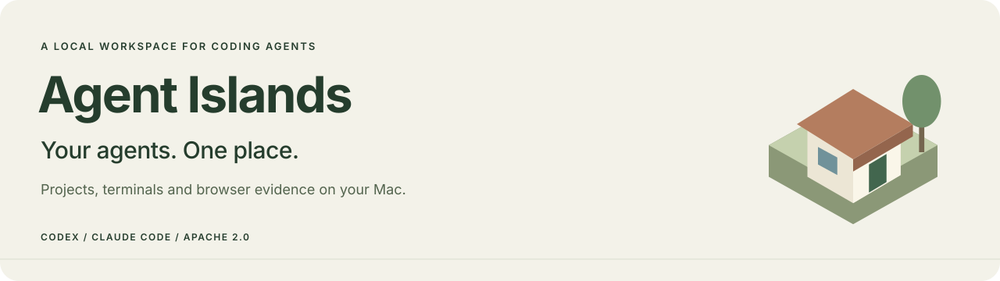
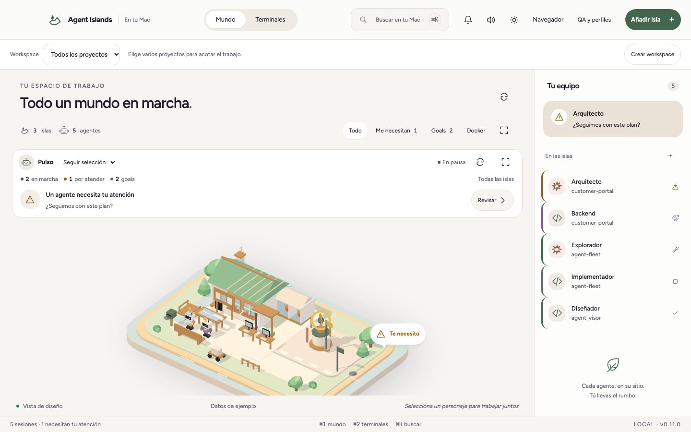
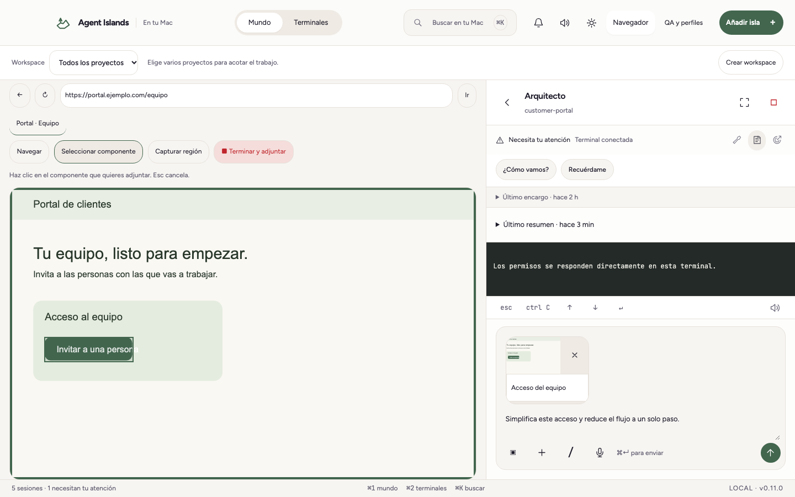
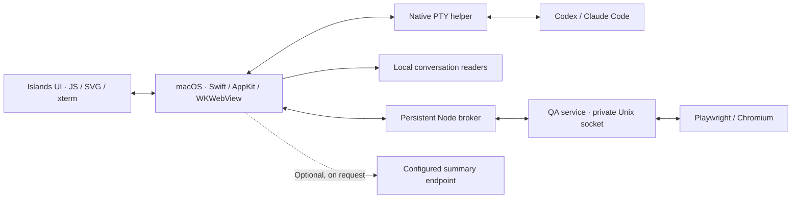

<p align="left">
  
</p>

<p>
  <a href="LICENSE"></a>
  
  
</p>

**A local macOS workspace for Codex and Claude Code.** Bring projects, terminals, saved conversations and browser evidence into one place. Each project becomes an island; its agents show what is running, waiting or finished.

[Español](README.es.md) · [Get started](#get-started) · [Features](#what-you-can-do) · [Architecture](docs/ARCHITECTURE.md) · [Contribute](CONTRIBUTING.md)

<picture>
  <source media="(prefers-color-scheme: dark)" srcset="docs/assets/workspace-dark.png">
  
</picture>

*Actual app UI with demonstration data. The app supports Spanish and English; screenshots show Spanish.*

## Why Agent Islands

Switching between agent terminals makes it easy to lose the project, the account and the last useful piece of context. Agent Islands keeps those connections visible: the directory a conversation belongs to, the profile it runs under, the goal it is pursuing and the evidence behind a browser check.

Use the familiar CLI harnesses in real terminals. Return to a conversation from its original directory. Open a deployed page, point at the part you want changed and send that reference with your next message.

## What you can do

| Workflow | In Agent Islands |
| --- | --- |
| **Several projects at once** | Named workspaces group directories, choose a primary project and scope the visible context. Running sessions keep their original roots. |
| **New or saved conversations** | Choose an active directory, add a new one, or restore the directory from a saved conversation. Search across the configured profiles. |
| **Separate accounts** | Configure multiple Codex and Claude Code profiles, including a `claude-personal` profile with its own configuration directory. |
| **Real agent terminals** | Native PTYs, xterm rendering, a terminal board and an inspector alongside the project island. |
| **Progress when you return** | Conversation checkpoints record the last consultation, a progress summary and product-level changes. Optional AI summaries show their source and time. |
| **Goals with explicit states** | Working, blocked, paused and complete are distinct. `stalled` maps to blocked; `in_progress` to active; `achieved` to complete. Token usage is a budget, not a completion percentage. |
| **Point to a visual change** | Control a Chromium page in the app, select a component or crop a region, and add the reference to your draft. |
| **Describe a flow** | Record a browser interaction and attach its video, frames and step context. Review the draft before sending it to the selected harness. |
| **Check deployed environments** | Register an origin, authenticate a QA profile, run a recipe or a project's Playwright suite, and inspect linked evidence. |
| **Local tools** | Browse and edit project files, inspect Docker containers and ports, and dictate a message with macOS speech recognition. |

### From a browser observation to a change



1. Register an environment under **QA y perfiles → Entornos**.
2. Open its browser from an agent and complete sign-in if needed.
3. Select a component, capture a region, or record the flow.
4. Write the requested change and press **Enviar**.

References stay in the draft until you send them. The harness receives a local manifest and associated image paths; a recording also carries its video, sampled frames and steps. How each model uses those files depends on the harness and model. See [browser and QA setup](docs/QA.md).

## Get started

Agent Islands is a **developer preview**. Build from source on macOS 14 or later. The project does not currently provide a notarized public installer.

### Requirements

- A Mac with Apple Silicon or Intel, macOS 14+, and Xcode Command Line Tools.
- Node.js **24.22.2** and npm; see [`.node-version`](.node-version).
- [Codex CLI](https://github.com/openai/codex), [Claude Code](https://code.claude.com/docs/en/overview), or both, installed and authenticated separately.
- Python 3 to run the PTY tests. Docker is optional.

The build targets the host architecture. Apple Silicon is validated locally; Intel builds need validation on an Intel Mac. Provider subscriptions and model access are separate from this project.

### Build and launch

From the repository directory:

```bash
git clone https://github.com/AlexHHPS/agent-islands.git
cd agent-islands
npm ci
npm run check
npm run build
open "build/Agent Islands.app"
```

The build creates:

```text
build/Agent Islands.app       Native app for your Mac's architecture
dist/Agent Islands.dmg       Local installer image
```

It downloads a pinned Node runtime, verifies its SHA-256 against [committed checksums](config/runtime.json), bundles Playwright and signs the app locally with an ad hoc signature. The DMG is **not notarized**. See [development](docs/DEVELOPMENT.md) for toolchain, validation and troubleshooting.

### First run

Choose **Castellano** or **English** under the settings button → **Application language / Idioma de la aplicación**. Your choice is saved and applies immediately. The native app initially follows the Mac's preferred language, falling back to English.

1. Add a project directory. Its island appears in the workspace.
2. Start an agent with the **+** control; choose its harness, profile and directory.
3. To return to earlier work, choose a saved conversation in the launch dialog.
4. Use **Workspaces** to group related projects and select the primary directory.
5. For browser features, open **QA y perfiles → Salud → Preparar QA** to download Chromium, then register an environment.

For UI exploration without the native backend:

```bash
npm run preview
```

Open [the local demonstration](http://127.0.0.1:8768/?preview=1). It uses fixture data and cannot run agents. The app itself loads bundled files in WKWebView and does not run this preview server.

## Profiles and workspaces

A **profile** selects a harness executable and a separate configuration root. For example, give `claude-personal` its own Claude configuration directory and authenticate that directory with the CLI before using it. Configure profiles in **QA y perfiles → Perfiles**. API credentials are not copied between profiles by Agent Islands.

A **workspace** groups two or more projects and determines the visible conversations, summaries and QA context. A launched session captures its project roots; switching workspace preserves that running session and its draft.

Directory scope organizes context and harness arguments. It is not an operating-system security boundary. Agent processes retain the filesystem and network permissions granted to their CLI harness. Permission bypass is an explicit per-launch option, with a visible indicator.

## Optional summaries

The terminal, workspaces, history and QA do not require an Islands summary provider. To enable generated summaries:

1. Open **QA y perfiles → IA**.
2. Enter a Chat Completions-compatible endpoint and a model identifier supported by it.
3. If required, save the API key using the native macOS Keychain dialog.
4. Request a summary from an agent or project.

HTTPS endpoints are supported; plain HTTP is accepted only on loopback. Automatic refresh starts **off** each time the app opens. When requested, selected context and conversation excerpts are sent to the configured endpoint. Keys stay out of the web UI and are associated with the exact endpoint. Compatibility depends on the server; see [privacy and data](docs/PRIVACY.md).

## QA with evidence

A check should say what was tested, under which account and against which revision.

- Authentication state is scoped by profile, environment and test account.
- Recipes can navigate, click, fill and assert page conditions.
- Project suites run their existing Playwright configuration unchanged.
- Runs retain checks, screenshots and results; optional revision checks detect a changed deployment.
- Results distinguish passed, failed, blocked, skipped, cancelled, interrupted and stale.
- Resource leases coordinate concurrent checks. A suite with only skipped tests does not count as a pass.

Read-only recipes block mutating HTTP methods as a best-effort guard; they do not guarantee that a website cannot change state. Project suites execute project code and need a trusted checkout. Use test accounts and environments appropriate to the flow. [QA guide →](docs/QA.md)

## How it fits together



There is no Electron runtime, hosted Agent Islands account or application backend to deploy. The desktop UI uses the system WebKit renderer; interactive testing uses a separate Chromium runtime. [Architecture and source map →](docs/ARCHITECTURE.md)

## Local data and privacy

App-owned state lives in `~/Library/Application Support/Agent Islands/`. This includes project and profile configuration, checkpoints, QA records, authentication state and visual evidence. Optional summary API keys live in macOS Keychain. Provider conversations remain in their provider's configuration directories and are read locally for discovery and context.

Agent harnesses, configured summary servers and the websites you visit can send data over the network. Screenshots, recordings and test authentication can contain sensitive information. Review evidence before sharing it; never attach raw local logs or auth state to an issue. [Data locations, network paths and cleanup →](docs/PRIVACY.md)

## Development

```bash
npm ci
npx playwright install chromium
npm run check
npm run build
npm test
npm run test:native
npm run check:source
npm run check:secrets
```

The suite exercises terminal behavior, conversation restore, workspace scope, checkpoints, goal transitions, browser references, real Chromium QA, MCP and the native broker. `test:native` uses isolated fixtures for the app smoke test. It does not send a real prompt to a provider.

GitHub Actions runs checks, builds and fixture tests on macOS. Inspect the [actual workflow runs](https://github.com/AlexHHPS/agent-islands/actions/workflows/ci.yml) for the status of a revision.

| Read next | What it covers |
| --- | --- |
| [Development](docs/DEVELOPMENT.md) | Toolchain, commands, test isolation, known limitations |
| [Architecture](docs/ARCHITECTURE.md) | Native bridge, harness integration, browser service, state handling |
| [QA guide](docs/QA.md) | Environments, profiles, recipes, existing suites and MCP |
| [Localization](docs/LOCALIZATION.md) | Shared catalogues, translation workflow and language behavior |
| [Design](docs/DESIGN.md) | Identity, logo, tokens, accessible states and screenshot fixtures |
| [Browser research](docs/BROWSER-RESEARCH.md) | Evaluation scope for alternative engines and automation layers |
| [Releasing](docs/RELEASING.md) | Clean source archive, validation, signing and publication steps |
| [Changelog](CHANGELOG.md) | Curated changes by version |

## Contributing

Start with [CONTRIBUTING.md](CONTRIBUTING.md). Reproducible bug reports, documentation fixes, accessibility improvements, provider compatibility checks and tests on Intel Macs are useful contributions. Include the observed behavior, expected result and sanitized reproduction steps.

The project follows a [code of conduct](CODE_OF_CONDUCT.md) and a documented [governance process](GOVERNANCE.md). Use [support](SUPPORT.md) for questions and report vulnerabilities through [SECURITY.md](SECURITY.md).

### Current limits and next work

- Spanish and English are supported throughout the app; additional locales are welcome. See [localization](docs/LOCALIZATION.md).
- Conversation and goal adapters depend on evolving CLI data formats. Unknown data is treated conservatively; full parity between providers is not guaranteed.
- macOS only. Intel support is a build path awaiting hardware validation.
- Public release signing, notarization and distribution are pending.
- Alternative browser engines are research, not bundled production integrations.
- Stronger automated compatibility checks and retention controls remain useful next steps.

## License and acknowledgements

Agent Islands is available under the **[Apache License 2.0](LICENSE)**. Third-party components keep their own licenses; see [THIRD_PARTY_NOTICES.md](THIRD_PARTY_NOTICES.md), including the original notices for Diorama, xterm, the bundled fonts, Node.js and Playwright.

**Using Agent Islands commercially?** Contact [@AlexHHPS](https://github.com/AlexHHPS) through [Discussions](https://github.com/AlexHHPS/agent-islands/discussions) to discuss integrations, collaboration or commercial support. Contact is optional: Apache 2.0 permits commercial use without asking permission or paying a license fee.

The Apache terms apply to this revision. Earlier public revisions through [`a4d6705`](https://github.com/AlexHHPS/agent-islands/blob/a4d670518e059fec07ae102b50e579503c64f9bc/LICENSE) were offered under MIT; their existing permissions are unchanged.

The Agent Islands logo and documentation assets are included under Apache 2.0 unless a file states otherwise. Codex, Claude Code, macOS and Chromium are names of their respective owners. This is an independent project.
